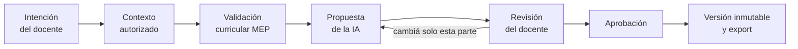

<div align="center">

# Catarina

**Plataforma de coelaboración pedagógica para docentes de Costa Rica**

El docente decide. La IA propone. Lo aprobado no se toca.


</div>

---

## Qué es

Un entorno donde el docente construye su planeamiento didáctico conforme al MEP partiendo de una idea propia («empecemos con un juego de palabras»), con apoyo de IA que **propone pero no decide**. La plataforma recuerda el contexto de cada grupo y las decisiones del docente, entrega materiales listos para el aula y no depende de ningún proveedor de IA.

No es un generador de planes automáticos ni un GPT personalizado. La circular MEP 2026 pide que el docente diseñe y redacte su planeamiento; la plataforma es **coelaboración**.

## Cómo trabaja el docente



| Principio | En la práctica |
|---|---|
| **Lo aprobado es intocable** | Una sección aprobada queda idéntica byte a byte hasta que el docente la reabre |
| **Memoria con procedencia** | El sistema recuerda grupos y preferencias, explica *por qué* lo recordó y nunca convierte una suposición de la IA en un hecho |
| **Privacidad de menores** | Las identidades viven en una bóveda cifrada; la IA nunca las ve |
| **IA intercambiable** | Cambiar de proveedor no pierde memoria, versiones ni aprobaciones |
| **Materiales reales** | Hojas para estudiantes completas, con título natural y consignas claras |

## Estado

El proyecto está en **especificación**: no hay código todavía. Toda la arquitectura es una propuesta pendiente de aprobación; nada normativo ni legal está validado.

| Hay | Falta |
|---|---|
| Visión, investigación y requisitos de producto (`idea/`) | Decisión de stack y equipo |
| Línea base de ingeniería completa (`docs/`) | Validación curricular por especialistas MEP |
| Contratos OpenAPI, AsyncAPI, JSON Schema y MCP | Revisión legal y DPIA |
| Plan de trabajo por paquetes, apto para agentes en paralelo | Implementación |

## Por dónde empezar

| Si querés… | Leé |
|---|---|
| Entender la idea y su origen | [`idea/00_COMENZAR_AQUI.md`](idea/00_COMENZAR_AQUI.md) |
| Ver qué se construye y para quién | [PRD](docs/01-PRD.md) |
| Entender el proceso pedagógico | [Modelo de dominio](docs/03-Domain-Model-Pedagogy.md) |
| Conocer los requisitos | [SRS](docs/02-SRS.md) |
| Ver la arquitectura | [SAD](docs/04-Software-Architecture.md) y [diagramas](docs/diagrams/README.md) |
| Planificar el desarrollo | [Roadmap](docs/11-Roadmap-MVP.md) y [WBS para agentes](docs/13-WBS-Agentes.md) |
| Saber qué falta decidir | [Decisiones abiertas](docs/12-Open-Decisions.md) |

Índice completo de la documentación de ingeniería: [`docs/README.md`](docs/README.md).

## Estructura

```
catarina/
├── idea/   Suite v0.4: visión, pedagogía, investigación EdTech y gobierno (fuente de autoridad)
└── docs/   Línea base de ingeniería: PRD, SRS, arquitectura, datos, IA, seguridad, pruebas, roadmap
    ├── adr/            Decisiones de arquitectura (todas Proposed)
    ├── contracts/      OpenAPI 3.1, AsyncAPI 3.0, JSON Schema, herramientas MCP
    ├── diagrams/       C4, ERD, despliegue, flujos de datos, secuencias, estados
    └── traceability/   Matriz necesidad → requisito → componente → ADR → prueba
```

---

<sub>Alcance inicial: I y II ciclos, Español, Matemática, Estudios Sociales y Educación Cívica, y Ciencias. Sin datos reales de estudiantes en ejemplos ni pruebas.</sub>
