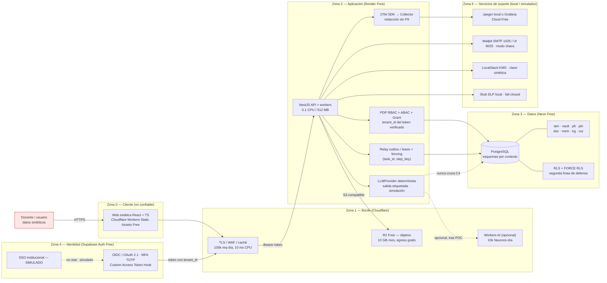
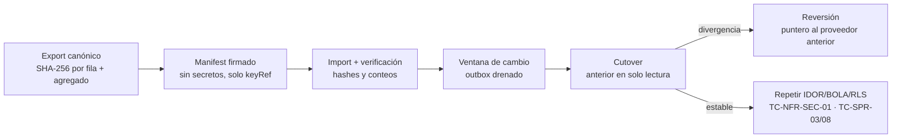

# 14 — Arquitectura del MVP demostrable y ruta de migración (Propuesta)

- **Estado:** Propuesta — acompaña a [ADR-024](adr/ADR-024-mvp-free-tier.md). No cambia el estado de ningún ADR ni de los contratos.
- **Fecha:** 2026-11-22
- **Deciders:** pendiente — H-PO / H-TL
- **Datos de cuotas:** verificados en fuentes oficiales el **2026-11-22**. Lo que no pudo confirmarse se marca literalmente **pendiente de verificar**. Las cifras son observaciones de documentación pública, no garantías contractuales ni ofertas comerciales.
- **Relacionado:** [04 SAD](04-Software-Architecture.md), [05 Especificaciones](05-Technical-Specifications.md), [06 Datos](06-Data-Architecture.md), [08 Concurrencia §7](08-Concurrency-Consistency.md), [09 Seguridad](09-Security-Privacy.md), [10 Pruebas](10-Test-Strategy.md), [11 Roadmap](11-Roadmap-MVP.md), [12 Decisiones abiertas](12-Open-Decisions.md), [13 WBS](13-WBS-Agentes.md); ADR-001/002/006/008/012/013/015/019/020/022/024.

## 0. Principios de esta propuesta

1. El **MVP demostrable** se ejecuta con datos **sintéticos** y sin PII; el piloto con docentes reales es un entorno distinto (§F).
2. **«Gratis» no implica disponibilidad, backups, residencia ni seguridad suficiente.** Ningún tier gratuito se presenta como apto para producción.
3. Los límites de cuota son **disparadores de migración** medibles (§E), no objetivos de diseño.
4. Las elecciones que requieren validación humana permanecen como **Propuestas**: no se aceptan ADR, no se congelan contratos y no se cierran gates.
5. Los contratos en `docs/contracts/**` siguen **Proposed**; **AsyncAPI está bloqueado por el rechazo de telemetría externa** en revisión automática (ver [contracts/README.md](contracts/README.md), bloqueo B2). Este documento no intenta eludir ese bloqueo.

---

## A. Diagrama de componentes y flujos



**Flujo de escritura (C4 nunca cruza):** el docente confirma → API valida token y `tenant_id` → **PDP** decide RBAC/ABAC/Grant → transacción en PostgreSQL con `FORCE RLS` → `outbox_event` en la **misma transacción** (ADR-005/008) → relay con lease/fencing y `UQ(task_id, step_key)` → consumidores registran `processed_event` (docs/08 §7). El adaptador IA **propone** un `Patch`; la aprobación la emite el docente, nunca el modelo.

```mermaid
sequenceDiagram
  participant W as Web (no confiable)
  participant E as Borde
  participant A as API NestJS
  participant I as IdP (Supabase Auth Free)
  participant P as PDP
  participant D as PostgreSQL (Neon Free)
  participant O as Outbox/Relay
  participant M as LLMProvider (simulado)

  W->>E: petición + Bearer token
  E->>A: reenvío (TLS terminado)
  A->>I: verificación de firma / aal / amr
  I-->>A: tenant_id del token (nunca del cliente)
  A->>P: decide(actor, recurso, acción, contexto)
  P-->>A: permitido / denegado
  opt propuesta de IA
    A->>M: generar borrador
    M-->>A: salida etiquetada "simulación" (sin C4)
  end
  A->>D: BEGIN; INSERT dominio + outbox_event (RLS FORCE)
  D-->>A: COMMIT
  A->>O: relay con lease/fencing + (task_id, step_key)
  O->>D: efecto idempotente + processed_event
```

### Límites de confianza y aplicación de RLS/PDP

| Frontera | Entre | Control aplicado | Dónde se aplica |
|---|---|---|---|
| B1 | Cliente → borde | HTTPS/TLS, validación de esquemas (`additionalProperties: false`), sin PII en payloads | Borde (Cloudflare) + API |
| B2 | Borde → aplicación | Verificación de token OIDC; `tenant_id` **del token verificado**, nunca del cuerpo/query | API NestJS, middleware de autenticación |
| B3 | Aplicación → PDP | Decisión RBAC + ABAC + Grant antes de cada lectura/escritura; `authz_version` al revocar | Servicio PDP en servidor (ADR-012) |
| B4 | Aplicación → PostgreSQL | **RLS con `FORCE RLS`** como segunda línea; roles de aplicación **sin `BYPASSRLS`** | Motor PostgreSQL, por tabla de tenant |
| B5 | Identidad → aplicación | MFA TOTP real (`aal`/`amr`), Custom Access Token Hook; SSO institucional **simulado** | IdP + verificación en API |
| B6 | Aplicación → objetos | Keys inmutables + manifest con hash; R2 cifrado AES-256 GCM | Adaptador de objetos |
| B7 | Aplicación → IA | `LLMProvider` determinista; salida marcada como simulación; C4 nunca cruza | Puerto de modelos |
| B8 | Aplicación → soporte | Redacción en Collector, stub DLP fail-closed, KMS solo como emulador local | Observabilidad / DLP / claves |

> **Prueba obligatoria de RLS:** `FORCE RLS` debe verificarse con un **rol no dueño**. Los roles administrativos con `BYPASSRLS` **invalidan la prueba**; un test enumera todas las tablas y exige política + `FORCE` con las excepciones explícitas documentadas (docs/06, § de RLS).

---

## B. Tabla por componente (datos verificados 2026-11-22)

| Componente | Opción MVP | Cuota/límite + fuente/fecha | Real o simulado | Limitación | Alternativa local | Proveedor/clase futuro |
|---|---|---|---|---|---|---|
| **Web / borde** | Cloudflare Workers Static Assets Free | Assets estáticos gratis e ilimitados; Worker 100k req/día, 10 ms CPU, 128 MB, bundle 64 MiB, startup 1 s. Sin tarjeta y **sin cláusula personal/no comercial** en términos consultados (2026-11-22). `developers.cloudflare.com/workers/static-assets/`, `/workers/platform/limits/`, `/workers/platform/pricing/` | Real (tier free) | Pages sigue vigente pero Cloudflare desaconseja proyectos nuevos; Vercel Hobby ToS §4 (19-oct-2026) prohíbe uso personal/no comercial → **NO apto para piloto con docentes** (`vercel.com/legal/terms`); GitHub Pages solo sitio estático, 1 GB, 100 GB/mes *soft limit* | Servidor estático local (Vite preview) | Cloudflare Pages/WAF; CDN + dominio propio |
| **API** | Render Free ejecutando NestJS | 0.1 CPU / 512 MB; 750 h/mes por workspace; 5 GB egress; 500 min build; spin-down tras 15 min (~1 min cold start); disco efímero; «no usar para producción». Sin tarjeta (**pendiente de verificar** el literal). `render.com/docs/free` | Real (tier free) | Cold start ~1 min; efímero → nada de estado local; 750 h compartidas por workspace | `node`/`pnpm dev` local; contenedor Docker | Render Paid / contenedores administrados; VM Always Free |
| **API (alternativa evaluada)** | Cloudflare Workers con NestJS | FAQ oficial: «Nest doesn't officially support it»; requiere `httpServerHandler` + `nodejs_compat`, DI con `@Inject`, ~500 KB gzip, bootstrap por isolate, 10 ms CPU y 1 s startup. `docs.nestjs.com/faq/cloudflare-workers`, `developers.cloudflare.com/workers/runtime-apis/nodejs/http/` | **POC obligatoria** antes de afirmar compatibilidad | Soporte no oficial; restricción de CPU y arranque | Mantener NestJS en Node local | Workers Paid $5/mes solo si la POC pasa |
| **API (otras alternativas)** | Oracle / Railway / Fly.io / Koyeb | Oracle Always Free: VM Ampere 2 OCPU/12 GB, 10 TB egress, siempre encendida, requiere tarjeta, esfuerzo alto y riesgo *out of host capacity*. Railway Free: $1/mes de crédito, duerme 5–10 min. Fly.io: $1 one-time o $5/mes con riesgo de pasar a PAYG y facturar. Koyeb: ya no tiene web service gratis | Real / evaluadas | Requieren tarjeta o duermen; riesgo de facturación inesperada | Docker Compose local | VM/container administrado con SLA |
| **BD** | Neon Free (**recomendado MVP**) | $0 sin tarjeta; 100 proyectos; 100 CU-h/proyecto/mes; 1 GB/proyecto y 20 GB total; scale-to-zero 5 min (**no desactivable**); 5 GB egress; history 6 h ≤1 GB; 1 snapshot manual; **sin backups/PITR de días**; 8 regiones AWS, región fija al crear. `neon.com/pricing` | Real (tier free) | Sin PITR multidía; región inmutable; scale-to-zero no configurable | PostgreSQL 16 en contenedor (docs/03 WP) | Neon Launch ~$15/mes con backups; PostgreSQL administrado |
| **BD (alternativa)** | Supabase Free | $0; 2 proyectos activos; 500 MB RAM; 500 MB BD; pausa ~7 días de inactividad; 5 GB egress; **sin backups ni PITR** (add-on PITR ~$100/mes); SAML SSO no incluido. `supabase.com/pricing`, `/docs/guides/platform/backups` | Real (tier free) | Pausa de 7 días; 500 MB; sin PITR; SSO de pago | PostgreSQL en contenedor | Supabase Pro $25 + PITR $100 |
| **BD (extensiones)** | JSONB, RLS, pgvector, btree_gist | JSONB/RLS/pgvector **confirmados** en ambos; `btree_gist` **confirmado en Neon**, **pendiente de verificar** en Supabase (2026-11-22) | Real | `FORCE RLS` debe probarse con rol no dueño; `BYPASSRLS` de roles admin invalida la prueba | Migraciones y extensiones en contenedor | Iguales en proveedor pagado |
| **Identidad** | Supabase Auth Free | 50.000 MAU; OAuth 2.1 Server; Custom Access Token Hook; MFA TOTP real (`aal`/`amr`); logs 24 h; SAML SSO, session timeouts y passkeys estables son de pago/experimentales. `supabase.com/pricing`, `/docs/guides/auth/auth-mfa` | Real (tier free); **SSO institucional simulado** | Logs solo 24 h; SSO de pago/experimental | Keycloak local u IdP de prueba (WP-11) | IdP institucional / OIDC empresarial con SSO |
| **Identidad (otras)** | Auth0 / Clerk / Zitadel | Auth0 Free 25k MAU sin roles/MFA avanzado; Clerk Hobby sin MFA; Zitadel Free 100 DAU (2026-11-22) | Real / evaluadas | Cobertura insuficiente de MFA/roles o DAU bajos | Keycloak local | IdP pagado con MFA y SSO |
| **Autorización** | PDP interno RBAC + ABAC + Grant + RLS | Sin cuota de proveedor; `tenant_id` del **token verificado**, nunca del cliente (ADR-012/020) | Real (código propio) | SSO simulado; ReBAC limitado | PDP en proceso con BD local | PDP centralizado / servicio de autorización |
| **Objetos** | Cloudflare R2 Free | 10 GB-mes; 1M Class A / 10M Class B ops; egress gratis; S3-compatible; cifrado AES-256 GCM; **sin versionado nativo** → keys inmutables + manifest con hash. `developers.cloudflare.com/r2/pricing/`, `/r2/reference/data-security/` | Real (tier free) | Sin versionado nativo; implementar inmutabilidad en la aplicación | MinIO local (S3-compatible) | R2 pagado / S3 con versionado nativo |
| **Objetos (alternativa)** | Supabase Storage Free | 1 GB / 50 MB por archivo (2026-11-22) | Real | Límite pequeño; sin garantía de versionado | MinIO local | Object storage administrado con versionado |
| **IA** | `LLMProvider` determinista local | Sin cuota; salida etiquetada como **simulación**, C4 nunca cruza | **Simulado (adaptador real de interfaz)** | No es un modelo real; apto solo para demo | Ollama local (alternativa **real**) | Proveedor de modelos con contrato de datos |
| **IA (opcional)** | Cloudflare Workers AI | 10.000 Neurons/día gratis; retención cero / sin entrenamiento; 300 req/min texto y 3.000 embeddings; **región/residencia pendiente de verificar**. `developers.cloudflare.com/workers-ai/platform/pricing/`, `/data-usage/` | Real (tier free) | Región/residencia sin confirmar (OD-03); cuota diaria | Ollama local | Modelo hospedado con residencia contractual |
| **Colas** | PostgreSQL + outbox / `processed_event` + lease/fencing + `(task_id, step_key)` | Sin cuota de proveedor; pruebas con **BD real** (docs/08 §7) | Real | Requiere disciplina de transacción y pruebas de concurrencia | PostgreSQL en contenedor | Cola administrada / Temporal (ADR-008/019) |
| **Colas (alternativa)** | Cloudflare Queues Free | 10k ops/día; retención 24 h **no configurable**. `developers.cloudflare.com/queues/platform/pricing/` | Real (tier free) | Retención corta fija; no transaccional con la BD | Outbox en PostgreSQL | Cola administrada con DLQ y retención configurable |
| **Observabilidad** | OpenTelemetry + Jaeger local o Grafana Cloud Free | Grafana Cloud Free $0; 10k series; 50 GB ingesta; 14 días retención; sin tarjeta. `grafana.com/pricing` | Real (Jaeger local) / real (Grafana free) | **Sin PII**; redacción obligatoria en el Collector | Jaeger + Prometheus locales | Grafana/Prometheus pagos con retención mayor |
| **CI** | Repo público + GitHub Actions | Runners gratis en repo público; GHAS (code/secret scanning, dependency review) gratis en público; SCA/SAST/SBOM/escáneres ya en CI. `docs.github.com/en/billing/...` (2026-11-22) | Real | Requiere repositorio público; AsyncAPI bloqueado por telemetría | Ejecución local de linters/pruebas | CI privada con runners propios |
| **Correo** | Mailpit local | SMTP 1025, UI 8025, **modo chaos** (2026-11-22) | Simulado | No entrega correo real; sin SLA | Mailpit | SES/Resend/Proveedor transaccional |
| **Claves** | LocalStack KMS | Emulador, **45/56 ops**; clave sintética **≠ KMS/HSM** (2026-11-22) | Simulado | No cumple ADR-022; nunca usar en piloto real | LocalStack / archivo de claves de desarrollo | KMS/HSM + gestor de secretos |
| **DLP / egress** | Stub DLP local | **Fail-closed** (2026-11-22) | Simulado | Cobertura limitada; matriz OD-16 pendiente | Stub local con reglas explícitas | DLP administrado + matriz de egress |

---

## C. Puertos de salida y puntos de reemplazo

Todos los adaptadores se inyectan mediante interfaces del lado de la aplicación (ADR-001/013). Cambiar de proveedor **no debe modificar reglas de dominio**; el adaptador MVP es reemplazado por uno de producción sin tocar casos de uso.

| Puerto | Adaptador MVP | Adaptador futuro | Punto de reemplazo / nota |
|---|---|---|---|
| Base de datos | Neon Free (PG con esquemas por contexto) | PostgreSQL administrado con PITR | `DatabasePort`: transacciones, RLS por sesión, migraciones por contexto |
| Identidad | Supabase Auth Free + PDP interno | IdP institucional + PDP central | `IdentityPort`: verificación de token, `tenant_id` del token, `aal`/`amr` |
| Objetos | R2 Free + keys inmutables + manifest | S3/R2 con versionado nativo | `ObjectStorePort`: `put` con hash, `get` verificado |
| Colas | Outbox en PostgreSQL + relay | Cola administrada / Temporal | `QueuePort`: `enqueue` transaccional, `ack` con `processed_event` |
| Correo | Mailpit (SMTP 1025, modo chaos) | Proveedor transaccional | `MailPort`: plantillas y reintentos fuera del dominio |
| Claves | LocalStack KMS (clave sintética) | KMS/HSM + gestor de secretos | `KeyVaultPort`: `encrypt`/`decrypt` con `keyRef`, nunca secretos en config |
| Observabilidad | OTel → Jaeger local / Grafana Free | Plataforma pagada con retención | `TelemetryPort`: `span`/`metric` sin PII; redacción en Collector |
| Modelos | `LLMProvider` determinista local | Proveedor de modelos con contrato de datos | `ModelPort`: salida etiquetada, sin efectos directos, C4 nunca cruza |

```ts
// Firma TypeScript mínima (contratos de salida, no implementaciones)
interface DatabasePort {
  transaction<T>(tenantId: string, fn: (tx: Tx) => Promise<T>): Promise<T>; // RLS FORCE por sesión
}
interface IdentityPort {
  verify(token: string): Promise<{ subject: string; tenantId: string; aal: string; amr: string[] }>;
}
interface ObjectStorePort {
  put(key: string, bytes: Uint8Array, sha256: string): Promise<void>;   // key inmutable
  get(key: string, expectedSha256: string): Promise<Uint8Array>;
}
interface QueuePort {
  enqueue(tx: Tx, event: DomainEvent): Promise<void>;                   // outbox en la MISMA tx
  ack(consumer: string, eventId: string, tx: Tx): Promise<void>;        // processed_event
}
interface MailPort { send(to: string, template: string, data: object): Promise<void>; }
interface KeyVaultPort {
  encrypt(keyRef: string, plaintext: Uint8Array, aad: Uint8Array): Promise<Uint8Array>;
  decrypt(keyRef: string, ciphertext: Uint8Array, aad: Uint8Array): Promise<Uint8Array>;
}
interface TelemetryPort { span(name: string, fn: () => Promise<void>): Promise<void>; } // sin PII
interface ModelPort {
  propose(input: RedactedInput): Promise<{ text: string; simulated: true; c4Crossed: false }>;
}
```

---

## D. Migración de datos y objetos

**Principio:** ninguna migración es irreversible. El proveedor anterior queda en **solo lectura** durante la ventana de cambio y la reversión es un cambio de puntero de configuración, no una reconstrucción.

| Paso | Acción | Verificación |
|---|---|---|
| 1. Export canónico | Volcado por registro con **SHA-256 por fila** y **SHA-256 agregado** por tabla/esquema | Conteos y hashes registrados en el manifest |
| 2. Manifest firmado | Firma del manifest; **sin secretos**, solo `keyRef`. Incluye versión de esquema, conteos, hashes, región y timestamp | Verificación de firma con `keyRef`; nunca secretos en el archivo |
| 3. Import | Carga en el proveedor destino con verificación de **hashes y conteos** | `hash(fila) == manifest`, `count == manifest`, 0 diferencias |
| 4. Objetos | Copia de keys inmutables y validación del manifest con hash por objeto | Misma verificación SHA-256; sin sobreescritura de keys |
| 5. Ventana de cambio | Congelar escrituras, drenar outbox, esperar `processed_event` sin pendientes | Outbox vacío y relay al día |
| 6. Cutover | Cambiar adaptador; proveedor anterior en **solo lectura**; observación reforzada | Smoke tests, latencia, errores, auditoría |
| 7. Reversión | Restaurar puntero al proveedor anterior si hay divergencia | Repetir verificación de hashes/contajes |
| 8. Seguridad post-migración | **Repetir IDOR/BOLA/RLS** tras migrar (TC-NFR-SEC-01, TC-SPR-03/08) | Informe de pruebas con `FORCE RLS` y rol no dueño |



---

## E. Disparadores verificables de migración

| Categoría | Disparador medible | Umbral / evidencia | Acción sugerida |
|---|---|---|---|
| Cuota BD | Compute agotado | **100 CU-h/proyecto/mes** (Neon Free) | Subir a Neon Launch ~$15/mes u optimizar consultas |
| Cuota BD | Almacenamiento | **1 GB/proyecto**, 20 GB total (Neon Free); 500 MB (Supabase Free) | Plan pagado / particionado / archivado |
| Cuota BD | Egress | **5 GB** (ambos free) | Plan pagado o CDN para lecturas |
| Cuota web | Peticiones | **100k req/día** (Worker) | Cloudflare Paid $5/mes o caché |
| Cuota web | CPU | **10 ms CPU** por invocación | Mover cómputo a la API |
| Cuota API | Horas | **750 h/mes por workspace** (Render Free) | Plan pagado / VM Always Free |
| Backups | Necesidad de PITR | **Sin backups/PITR de días** (Neon y Supabase Free); PITR Supabase ~$100/mes | Plan con PITR antes del piloto real |
| Disponibilidad | Cold start | Spin-down ~1 min (Render, 15 min inactivo) | Servicio siempre encendido |
| Disponibilidad | Pausa de BD | ~7 días de inactividad (Supabase Free); scale-to-zero 5 min no desactivable (Neon) | Plan con mínimo cálido |
| Residencia | Región / OD-03 | Región fija al crear (Neon, 8 regiones AWS); Workers AI **pendiente de verificar** | Validar legalmente y elegir región contractual |
| Uso comercial | ToS | Vercel Hobby ToS §4 (19-oct-2026) prohíbe uso personal/no comercial | **NO usar Vercel Hobby** para piloto con docentes |
| Seguridad | BYPASSRLS | Roles admin con `BYPASSRLS` invalidan la prueba de `FORCE RLS` | Quitar `BYPASSRLS`, repetir TC-NFR-SEC-01 |
| Seguridad | KMS | Clave sintética de LocalStack ≠ KMS/HSM (ADR-022) | KMS/HSM real antes de datos reales |
| Coste | Umbrales de plan | Neon Launch ~$15/mes; Supabase Pro $25 + PITR $100; Cloudflare Workers Paid $5/mes | Reevaluar OD-09 con datos medidos |

---

## F. Separación de entornos

| Entorno | Datos | Proveedores | Controles | Propósito |
|---|---|---|---|---|
| **Desarrollo / demo sintético** | Solo sintéticos, sin PII | Local + free tiers (Neon/Supabase/Render/Cloudflare/Mailpit/LocalStack) | RLS y PDP activosEn pruebas; LLMProvider simulado; modo chaos | Demostrar el MVP y ejecutar TC-NFR-MNT-01, TC-NFR-PRV-01, TC-SPR-03/08 |
| **Piloto real** | Datos reales de docentes/estudiantes | **Planes pagos**, ningún tier gratuito como sistema de registro | **DPIA/legal (OD-03, §14–15 de docs/09)**, RLS/auditoría reales, KMS/HSM, PITR, SSO institucional definido (OD-04) | Validar con docentes reales bajo control legal |
| **Producción** | Datos reales en escala | Servicios administrados | **SLA, KMS/HSM, PITR**, residencia contractual, observabilidad con retención | Operación sostenible |

> **Explicitación:** «gratis» **no implica** disponibilidad (spin-down ~1 min, pausa ~7 días), **backups** (sin PITR multidía), **residencia** (región fija, Workers AI pendiente de verificar) ni **seguridad suficiente** (BYPASSRLS, KMS sintético, SSO de pago). El tier gratuito es una herramienta de demostración, no una promesa operativa.

---

## G. Trazabilidad

| ID | Cobertura en este documento |
|---|---|
| **WP-01** Esqueleto y reglas de dependencias | §C (puertos y adaptadores); `TC-NFR-MNT-01` (fitness arquitectónico) |
| **WP-02** Contratos v1 y mock | §A (flujo con contratos `Proposed`); §0.5 (AsyncAPI bloqueado por telemetría) |
| **WP-03** Harness de pruebas | §A (prueba de `FORCE RLS` con rol no dueño); §B (PostgreSQL real); `TC-NFR-PRV-01`, `TC-SPR-03` |
| **WP-10** IaC y entornos CI/CD | §B (CI), §F (dev/piloto/producción); `TC-SPR-08`, `TC-NFR-SEC-01` (**abierto**) |
| **TC-NFR-MNT-01** | §C — matriz de reemplazo de adaptadores |
| **TC-NFR-PRV-01** | §A/§B — sin PII, redacción en Collector, datos sintéticos |
| **TC-SPR-03 / TC-SPR-08** | §D paso 8 y §F — repetir IDOR/BOLA/RLS tras migrar; CI con SCA/SAST/SBOM |
| **TC-NFR-SEC-01 (abierto)** | §B (BYPASSRLS, KMS sintético) y §E — requiere cierre antes del piloto real |
| **OD-03** Retención y residencia | §B (región fija), §E (residencia), §F (DPIA/legal) |
| **OD-04** IdP y SSO institucional | §B (Supabase Auth, SSO simulado), §F (SSO en piloto) |
| **OD-09** Presupuesto/coste | §E (umbrales de coste), §F (planes pagos) |
| **OD-10** Stack resuelto | §B (React/TS, NestJS, PostgreSQL); versiones/licencias y AEAD siguen pendientes |
| **OD-11** Diseño y alcance del piloto | §F (piloto real vs demo sintética) |
| **OD-15** Aceptar/modificar ADR | §0.4 — todos los ADR siguen `Proposed`; este doc es propuesta |
| **OD-16** Matriz de egress | §B (stub DLP fail-closed), §F (controles de piloto) |
| **ADR-001/002/006/008/012/013/015/019/020/022** | §A (contextos, outbox, PDP/RLS, bóveda, sin Redis, observabilidad, claves), §C (puertos), §D (migración) |

**Nota de estado:** los contratos en `docs/contracts/**` permanecen **Proposed** y no se congelan. La validación de `asyncapi.yaml` sigue **bloqueada por telemetría externa** (bloqueo B2 en `contracts/README.md`); este documento no ejecuta ni habilita rutas que puedan evadir ese rechazo. Ningún gate humano se cierra aquí.

---

**Fin del documento.** Toda elección que requiera validación humana —proveedores, POC de NestJS en Workers, residencia (OD-03), uso con docentes reales y plan de pago— queda como **Propuesta** pendiente de H-PO/H-TL.
