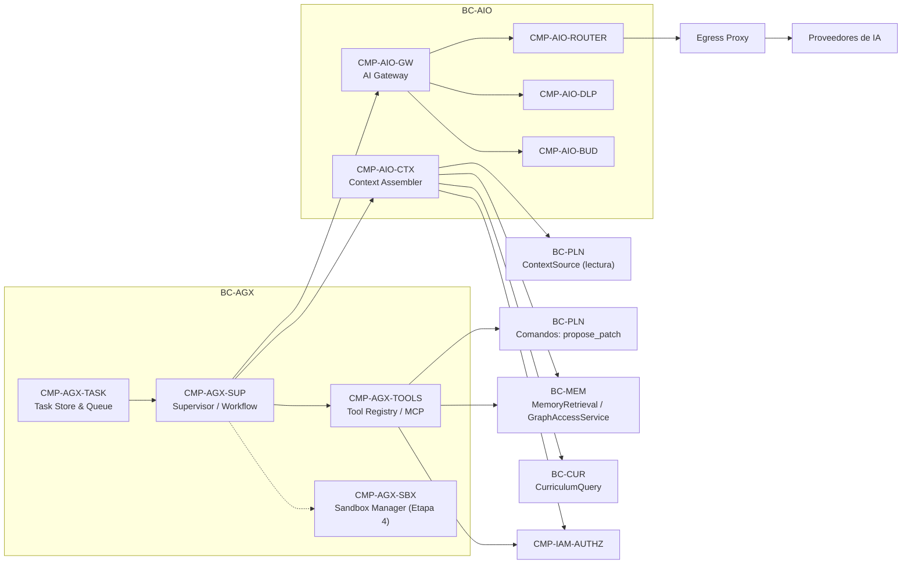

# C4 L3 — AI Orchestration y Agent Execution

Fuente: [04 §6](../04-Software-Architecture.md), [07](../07-AI-Agentic-Architecture.md). El LLM no tiene ruta a almacenes: solo recibe el contexto ensamblado y su salida vuelve como propuesta.

