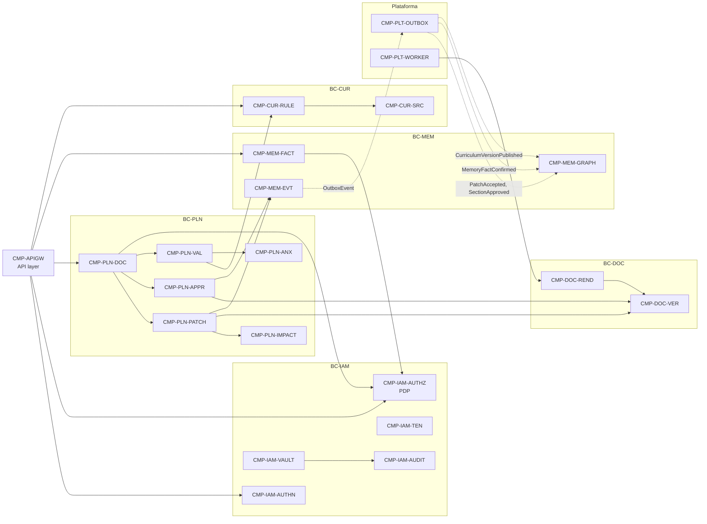

# C4 L3 — Componentes de dominio (API / Worker)

Fuente: [04 §5–6](../04-Software-Architecture.md). Las flechas respetan la matriz de dependencias de 04 §5.2; las líneas discontinuas son eventos vía outbox.

