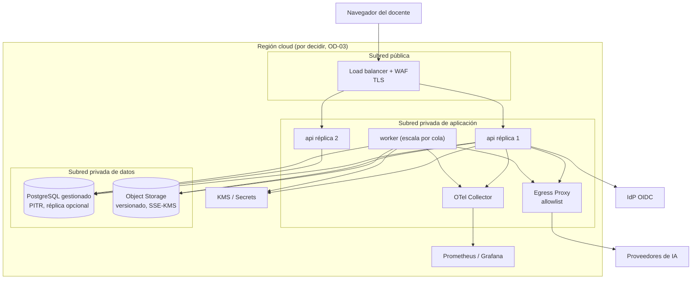

# Deployment View (prod)

Fuente: [04 §10](../04-Software-Architecture.md). Región única inicial (residencia: OD-03). Runtime de contenedores gestionado; sin Kubernetes en el MVP.

Entornos: `dev` (local, sintético), `staging` (sintético, dimensionado para carga), `prod` (único con datos reales, tras SPR-09).
