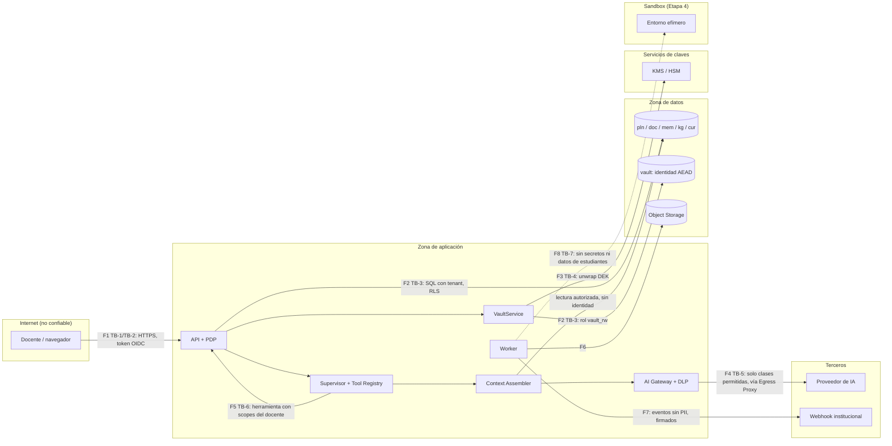

# Data Flow Diagram con trust boundaries

Fuente: [04 §11](../04-Software-Architecture.md), [09 §3–4](../09-Security-Privacy.md). Cada subgrafo es una zona de confianza; los flujos F1–F8 cruzan las fronteras TB-1 a TB-7.

Reglas visibles en el diagrama: ninguna flecha conecta `vault` con el gateway, el supervisor ni el sandbox; el proveedor de IA solo recibe datos desde el gateway.
