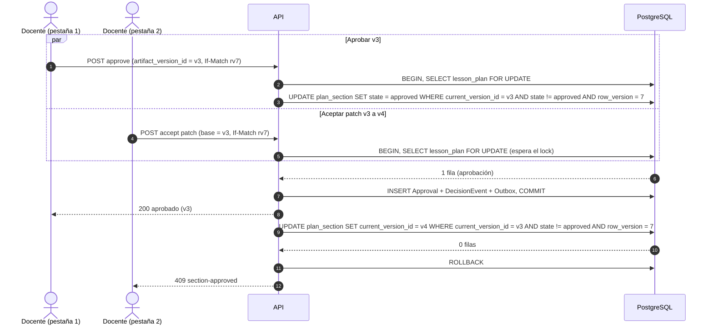

# Sequence — Carrera aprobación vs modificación (R-04)

Fuente: [08 R-04](../08-Concurrency-Consistency.md). Ambas solicitudes parten de la versión v3. Solo una gana; la otra recibe `409`.

Resultado alternativo válido: si el patch obtiene el lock primero, v4 queda como versión actual y la aprobación de v3 recibe `409 version-mismatch` porque ya no es la versión actual. Ningún otro resultado es aceptable.
