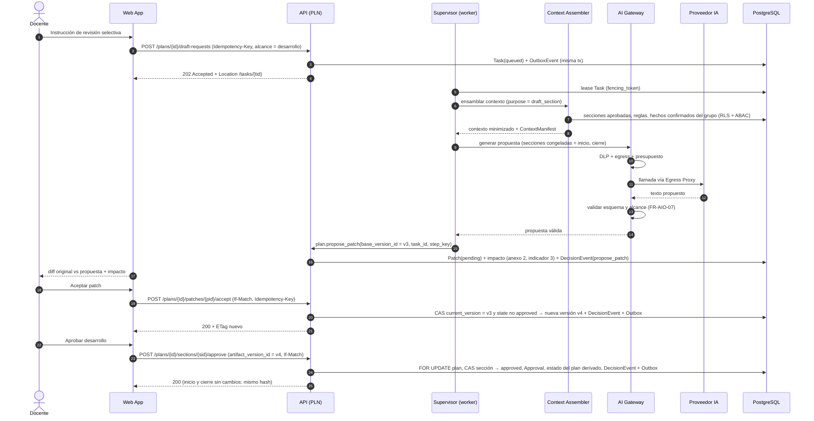

# Sequence — Coautoría: revisión selectiva, aceptación y aprobación

Fuente: [01 §7.1](../01-PRD.md), [03 §3](../03-Domain-Model-Pedagogy.md), [07 §3](../07-AI-Agentic-Architecture.md). Caso: «Dejá inicio y cierre; cambiá el desarrollo por una dinámica cooperativa».

