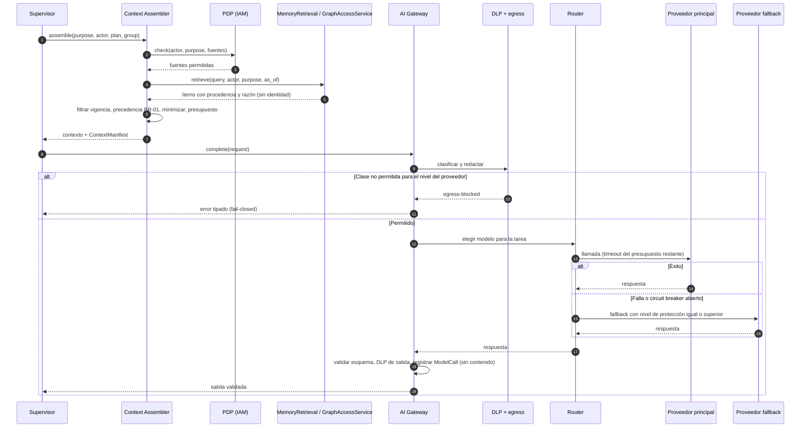

# Sequence — Ensamblaje de contexto, DLP, egress y degradación

Fuente: [07 §6, §9](../07-AI-Agentic-Architecture.md).

Si no hay proveedor permitido disponible, el sistema pasa a degradación L2: el editor, los validadores, el versionado y el export siguen funcionando (FR-AIO-04).
