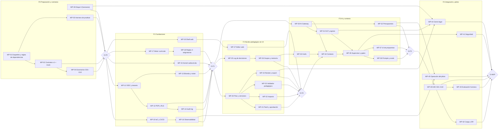

# Dependencias del WBS (fases y carriles paralelos)

Fuente: [13 §4–5](../13-WBS-Agentes.md). Cada subgrafo es una fase; dentro de una fase, los paquetes sin flecha entre sí se ejecutan en paralelo. Los rombos son gates humanos.

Las olas posteriores al MVP (WP-50 … WP-70) siguen la tabla de 13 §5.6 y empiezan después de G-MVP; no se dibujan aquí.

WP-30 (AI Gateway) puede empezar al cerrar G-F1, en paralelo con todo F2; solo WP-34 espera a G-F2, porque necesita el plan y la memoria terminados.
