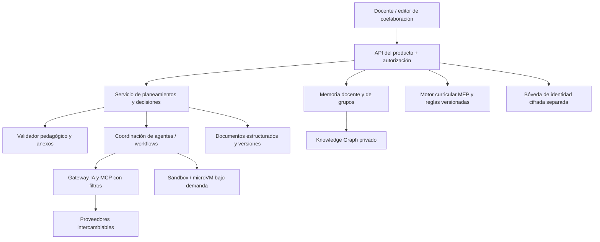

# Arquitectura v0.4: de la intención docente al material aprobado

## Dibujo conceptual

## Dominios de servicio
1. **Identity/Tenant:** docentes, institución, permisos, autenticación y claves separadas. 2. **Curriculum:** fuentes MEP, versiones y reglas por nivel/área/modalidad. 3. **Planning:** documentos estructurados, editor por bloques, anexos y exportación. 4. **Pedagogical memory:** eventos, perfiles, decisiones aprobadas, recuerdos confirmados y procedencia. 5. **Evidence/Evaluation:** indicadores, evaluación formativa y criterios. 6. **AI operations:** políticas de routing por costo/calidad, privacidad, modelos y conectores. 7. **Jobs:** tareas durables, aprobaciones, timeouts y límites de recursos. 8. **Observability:** auditoría, evaluación y costos sin incluir PII en logs.

## Sugerencia tecnológica no prescriptiva
Frontend TypeScript/React; backend con servicios en TypeScript o Python; PostgreSQL + RLS y pgvector; objetos versionados S3 compatibles; KMS externo; motor de workflows durable (Temporal u otro); orquestación agéntica mínima con adaptadores; microVM solo si requiere código/navegación; OpenTelemetry; evals pedagógicas propias. Evitar atarse a una sola biblioteca framework.

## Decisión operativa
Las operaciones comunes no usan microVM ni un equipo de cinco modelos; herramientas especializadas simples y validadores deterministas bastan. Reservar agentes complejos para tareas largas y riesgos controlados. La calidad pedagógica no depende del precio del modelo flagship.
